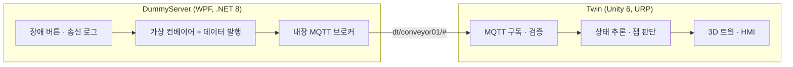

# Unity Conveyor Digital Twin

벨트 컨베이어 1대를 대상으로 한 Unity 디지털 트윈 포트폴리오입니다.
CAD 임포트 → 외부 데이터 연동(MQTT) → 장애 대응 → HMI까지 디지털 트윈 파이프라인 전체를 한 바퀴 구현하는 것이 목표입니다.

> 🚧 1단계 개발 중

## 구성

| 폴더 | 내용 |
| --- | --- |
| `src/Shared` | 토픽과 페이로드 규약 (netstandard2.1, 서버·트윈 공용) |
| `src/DummyServer` | 가상 설비 겸 MQTT 브로커, 장애 재현 UI |
| `Twin` | Unity 디지털 트윈 프로젝트 |
| `docs` | 통신 규약, CAD 파이프라인 문서 |
| `cad` | CAD 원본 보관 위치 (저장소 미포함) |

## 설계 원칙

- 서버는 **원시 신호만** 보내고, 상태 판단은 트윈이 한다.
- 장애는 "현실 쪽"에서 일어나므로 장애 버튼은 서버에 있다.
- 트윈은 데이터를 믿고 따라가되, 순서·중복·이상값·끊김을 스스로 검증한다.

자세한 규약은 [docs/protocol.md](docs/protocol.md)를 참고하세요.

## 실행 방법

(빌드 완료 후 작성)

## CAD 데이터 출처

컨베이어 모델은 mk Technology Group의 GUF-P 2000 STEP 데이터를 사용합니다.
라이선스상 원본과 변환본은 저장소에 포함하지 않으며, 받는 방법은 [cad/README.md](cad/README.md)에 있습니다.

## 로드맵

- [ ] 1단계: 컨베이어 1대, MQTT 연동, 장애 시나리오, HMI
- [ ] 2단계: 로봇 셀(ABB) 추가, OPC UA 연동 검토
