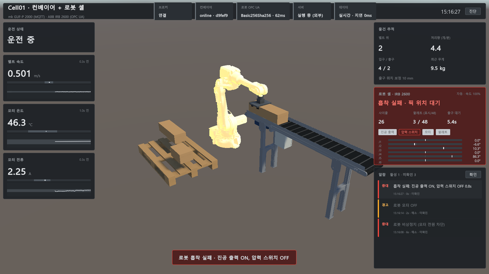
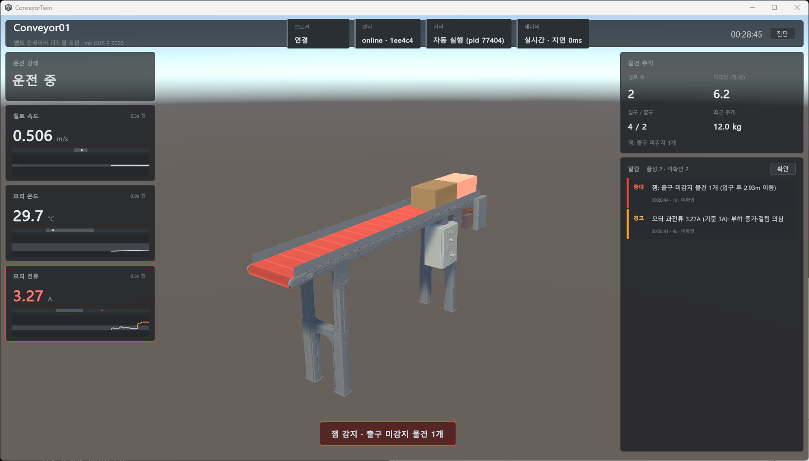
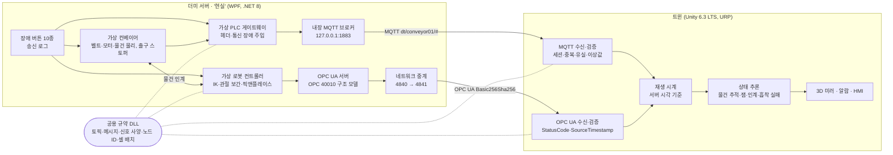

# Unity Conveyor Digital Twin

벨트 컨베이어와 ABB 로봇 팔레타이징 셀의 디지털 트윈입니다. 제조사 CAD를 가져와 3D 모델을 만들고,
가상 설비가 **MQTT(컨베이어)와 OPC UA(로봇)** 로 보내는 원시 신호를 받아
**현실에서 일어나는 일을 그대로 비추고, 신호 조합으로 이상을 추론해 운전자에게 알립니다.**

게임 클라이언트 개발자가 디지털 트윈 개발에 적응할 수 있는지 직접 보여주기 위한 포트폴리오입니다.
게임 개발에는 없던 세 가지, **CAD 임포트 · 외부 데이터 연동 · HMI와 배포**를 두 단계에 걸쳐 처음부터 끝까지 구현했습니다.

> 📺 시연 영상: [1단계 · 컨베이어](https://www.youtube.com/watch?v=DArOC5Hn-dg) · 2단계 · 로봇 셀 (준비 중)
>
> 📦 실행 빌드: Windows 10/11 64비트. `ConveyorTwin.exe` 하나만 실행하면 서버까지 자동으로 뜹니다. ([실행 방법](#실행-방법))





---

## 무엇을 보여주는가

| 영역 | 구현 | 근거 |
| --- | --- | --- |
| **CAD 임포트** | 컨베이어: mk GUF-P 2000 STEP(311부품) → FreeCAD 명령줄 스크립트 → glb. 볼트·너트 225개 제거, 역할별 7노드, 삼각형 77.5만 → 9.9만.<br/>로봇: ABB IRB 2600 STEP(링크별 12파일) → **인접 링크의 동축 원통면에서 관절 축 6개를 추출**(ABB 공개 치수와 일치) → 관절 계층 glb, Unity 회전 규약을 정기구학으로 검증 | [CAD 파이프라인](docs/cad-pipeline.md), [로봇 CAD](docs/cad-robot.md) |
| **외부 데이터 연동** | MQTT: QoS·Retained·Last Will, 세션·순번 헤더, 중복·유실·이상값·끊김 검증.<br/>OPC UA: OPC 40010 Robotics 구조의 정보 모델, **Basic256Sha256 보안 채널**, 신뢰 목록 기반 인증서, 세션 KeepAlive·재접속, StatusCode·SourceTimestamp 검증.<br/>두 프로토콜을 **하나의 재생 시계**(서버 시각 기준)로 맞물려 재생 | [통신 규약](docs/protocol.md), [로봇 OPC UA](docs/robot-opcua.md), [아키텍처](docs/architecture.md) |
| **상태 추론** | 서버는 판단을 보내지 않음. 센서 엣지 FIFO로 물건 추적·잼 판단, 진공 출력·압력 스위치 조합으로 흡착 실패 판단, 컨베이어 출구(MQTT)와 로봇(OPC UA)을 합쳐 "출구 대기" 판단. 박스 인계도 신호 조합으로 추론 | [`ItemTracker.cs`](Twin/Assets/Scripts/Twin/ItemTracker.cs), [`RobotTwin.cs`](Twin/Assets/Scripts/Twin/Robot/RobotTwin.cs) |
| **HMI** | ISA-101 원칙(정상은 회색, 색은 이상에만), ISA-18.2식 알람(발생·해소·확인), 부품별 셰이더 하이라이트, 로봇 셀 카드(IO·관절 가동 범위) | [Twin README](Twin/README.md#hmi-대시보드-1112일-차) |
| **배포** | 트윈 + self-contained 서버 단일 exe, 서버 자동 실행, 첫 실행 때 OPC UA 인증서 자동 발급. **Windows 샌드박스에서 장애 시나리오까지 자동 시험** | [배포 빌드](Twin/README.md#배포-빌드-13일-차) |
| **검증 자동화** | 관절 FK 대조, 셀 도달성(IK 48칸), OPC UA 연결·재연결, 플레이 모드 통합 점검(인계 오차 mm 측정), UI Automation으로 서버 장애 버튼 조작 | [검증](#검증) |

## 구조



부품별 책임, 메시지가 화면에 반영되는 경로, 잼 판단·박스 인계·인증서 발급 순서도는 [docs/architecture.md](docs/architecture.md)에 있습니다.

## 설계 원칙

| 원칙 | 의미 | 구현에서 드러나는 곳 |
| --- | --- | --- |
| **트윈은 현실의 거울** | 데이터의 주인은 현실(서버). 트윈은 값을 만들거나 고치지 않는다 | 데이터가 끊기면 마지막 데이터 끝에서 멈춰 기다림 (외삽 안 함). 로봇은 서버가 보낸 관절각만 따른다 (트윈은 IK 안 함). 통신이 끊긴 동안 놓인 박스는 관측처럼 그리지 않고 사이클 수·적재 레시피로 정한 칸에 회색 추정 박스로 구분 |
| **서버는 원시 신호만** | "잼", "흡착 실패" 같은 판단은 보내지 않는다 | 센서 엣지·속도·전류·진공 출력·압력 스위치만 받아 트윈이 잼·과전류·흡착 실패를 추론 |
| **장애는 현실 쪽에서** | 장애 버튼은 서버에 있고 트윈은 대응만 한다 | 로봇 통신 끊김은 서버가 아니라 네트워크 중계를 끊어 만든다 (로봇은 계속 일함). 서버가 꺼지면 트윈이 몰래 되살리지 않고 운전자에게 묻는다 |
| **믿되 맹신하지 않는다** | 순서·중복·이상값·끊김을 트윈이 스스로 검증 | seq·SourceTimestamp 순서 검사, 측정 범위·quality·StatusCode 검사, stale·KeepAlive, 관절 가동 범위 검사, 서버 재시작(sid·StartTime) 감지 |

## 장애 시나리오

서버 창의 버튼으로 장애를 일으키면 트윈이 대응합니다. 서버의 송신 로그("보낸 것")와 트윈 화면("받은 것")을 나란히 비교할 수 있습니다.

**컨베이어 (MQTT, 1단계)**

| 서버 버튼 | 서버에서 일어나는 일 | 트윈의 대응 |
| --- | --- | --- |
| 연결 끊김 | 소켓 강제 종료 → 브로커가 Last Will(`online: false`) 발행 | 설비 오프라인 알람, 화면 회색조. 복구되면 유실 구간을 인지하고 물건 추적 재동기화 |
| 전송 지연 3초 | 모든 메시지를 3초 늦게, 순서는 유지 | 화면을 서버 시각 기준으로 3초 늦게 재생 (이동 거리 보존)하고 "화면은 3초 전 상태" 표시. 해제되면 배속 재생으로 따라잡음 |
| 순서 뒤섞기 | 메시지별 0~250ms 지터 + 5% 중복 재전송 | 300ms 재생 지연 안에서 `ts` 순 정렬, 중복·과거 `seq` 폐기. 화면 흔들림 없음 |
| 이상값 송신 | 온도 999.9(측정 범위 밖), 전류 `quality: bad` | 값 거부, 마지막 정상값 유지 + 경고. 통신 문제(stale)와 구분해 알람 중복 방지 |
| 물건 걸림 | 박스가 멈추고 뒤 박스가 쌓임, 벨트는 미끄러지며 계속 돎, 전류 +1.2A | 과전류 경고 → 잼 중대 알람, 벨트·박스 빨강 맥동 |
| 모터 정지 | `state/run = fault`, 속도 0 | 모터·제어 박스 빨강, 벨트 정지, 잼 판단 보류 |

**로봇 셀 (OPC UA, 2단계)** — 상세: [docs/robot-faults.md](docs/robot-faults.md)

| 서버 버튼 | 서버에서 일어나는 일 | 트윈의 대응 |
| --- | --- | --- |
| 로봇 통신 끊김 | 트윈과의 네트워크만 끊김 (로봇은 계속 일함) | KeepAlive로 즉시 감지, 로봇 회색조·마지막 수신 자세. 재접속 후 끊긴 동안 바뀐 값만 반영하고, 못 본 적재는 회색 추정 박스로 구분해 표시 |
| 비상정지 | 즉시 정지·모터 전원 차단, 해제 1초 뒤 이어서 동작 | 비상정지 중대 알람, 로봇 빨강 맥동. 박스는 출구에 쌓이지만 잼으로 오판하지 않음 |
| 흡착 실패 | 진공을 켜도 압력이 안 잡힘 → 1초 뒤 진공 OFF·프로그램 정지 | **트윈이 추론**: 진공 출력 ON + 압력 스위치 OFF 0.5초 → 흡착 실패. 8초 뒤 "출구 대기" (MQTT+OPC UA 조합) |
| 관절 엔코더 이상 | 관절각 StatusCode = BadSensorFailure | 값 거부, 마지막 정상 자세 유지 + 경고. 그동안 놓인 박스는 멈춘 그리퍼 위치에 두지 않고 추정 박스로 |

## 통신 규약 요약

### 컨베이어: MQTT

토픽 `dt/{deviceId}/{category}/{signal}`, JSON(camelCase). 모든 데이터 메시지에 `sid`(세션), `seq`(토픽별 순번), `ts`(발행 시각 ms)가 붙습니다.

| 토픽 | 내용 | 주기 | QoS | Retained |
| --- | --- | --- | --- | --- |
| `status` | 연결 상태 (Last Will 대상) | 변경 시 | 1 | O |
| `state/run` | 가동 상태 `running`·`stopped`·`fault` | 변경 시 | 1 | O |
| `telemetry/belt_speed`·`motor_current` | 벨트 속도(m/s), 모터 전류(A) | 500ms | 0 | O |
| `telemetry/motor_temp` | 모터 온도(°C) | 1000ms | 0 | O |
| `telemetry/load_weight` | 입구 로드셀 무게(kg) | 물건 통과 시 | 1 | X |
| `sensor/entry`·`sensor/exit` | 광전 센서 엣지 `blocked` | 엣지 발생 시 | 1 | **X** |

- 주기 측정값은 하나쯤 잃어도 되므로 QoS 0, 재접속 즉시 화면을 복원하도록 Retained.
- 센서 엣지는 하나라도 놓치면 물건 추적이 틀어지므로 QoS 1, 재접속 때 과거 엣지가 다시 오면 물건이 생겨나므로 Retained 금지.

### 로봇: OPC UA

`opc.tcp://127.0.0.1:4840`, SignAndEncrypt + Basic256Sha256. OPC 40010 Robotics의 구조·이름을 따른 단순화 모델입니다.

```
RobotCell01/MotionDevices/IRB2600/JointPositions      Double[6] [deg]   ← 6축을 한 시각에 묶어 구독
RobotCell01/Controllers/IRC5/MotorsOn, SpeedOverride
          …/TaskControls/T_ROB1/ParameterSet/ExecutionState, CycleCount
          …/IO/DO_VacuumOn, DI_VacuumOk, DI_PalletPresent        ← 원시 IO (판단은 트윈)
RobotCell01/SafetyStates/SafetyState/ParameterSet/OperationalMode, EmergencyStop, ProtectiveStop
```

MQTT 위에 직접 만든 `sid`·`seq`·`ts`·`quality`가 OPC UA에는 서버 시작 시각·구독 순번·SourceTimestamp·StatusCode로 표준에 들어 있습니다.
Unity(Mono)는 자체 서명 인증서를 만들지 못하므로 서버 exe가 트윈 인증서를 발급하고 서로의 신뢰 목록에 넣습니다 (현장 GDS의 축소판).

전체 규약은 [docs/protocol.md](docs/protocol.md), [docs/robot-opcua.md](docs/robot-opcua.md)에 있습니다.

## 실행 방법

### 빌드 받아 실행

1. `ConveyorTwin` 폴더의 `ConveyorTwin.exe`를 실행합니다. 더미 서버가 자동으로 뜹니다 (`Server/ConveyorTwin.DummyServer.exe`).
   처음 실행할 때는 트윈이 서버로부터 OPC UA 인증서를 발급받습니다 (몇 초).
2. 서버 창의 **장애 주입** 버튼(컨베이어 6종, 로봇 셀 4종)을 눌러 보세요. 다시 누르면 복구됩니다.
3. 트윈 오른쪽 위 **진단** 버튼은 수신 상세(지연, 재정렬, 폐기, OPC UA 검증 통계)를 보여줍니다.

별도 설치는 필요 없습니다. 통신은 PC 안(MQTT 1883, OPC UA 4840, 모두 127.0.0.1)에서만 이루어집니다.

### 소스에서 빌드

필요한 것: .NET 8 SDK 이상, Unity 6000.3.20f1 (Unity 6.3 LTS), FreeCAD 1.1 (CAD 변환),
mk GUF-P 2000 STEP · ABB IRB 2600-20/1.65 STEP ([받는 방법](cad/README.md))

1. 서버 빌드 + Shared·MQTTnet·OPC UA DLL을 Unity로 복사: `dotnet build src`
2. STEP을 `cad/`에 두고 glb 변환 (결과가 `Twin/Assets/ThirdParty/Cad`로 복사됨):
   `"<FreeCAD>/bin/FreeCADCmd.exe" tools/cad/export_conveyor.py`, `"<FreeCAD>/bin/FreeCADCmd.exe" tools/cad/export_robot.py`
3. Unity로 `Twin` 폴더를 열고 메뉴 **Tools/Twin/Setup Scene** 실행 (씬·로봇 셀·머티리얼·한글 폰트 에셋 구성).
4. Play. 서버가 없으면 자동으로 실행됩니다. 서버만 따로 띄우려면 `dotnet run --project src/DummyServer`.
5. 배포 빌드: 메뉴 **Tools/Twin/Build Release** → `dist/ConveyorTwin/`.

CAD 원본·변환 메시·폰트 에셋은 저장소에 없으므로 2~3단계가 필요합니다.

## 검증

손으로 눌러 보는 대신, 확인할 수 있는 것은 수치로 확인하는 도구를 만들었습니다. 이 도구들이 실제 버그를 여럿 찾았습니다.

| 도구 | 확인하는 것 | 결과 |
| --- | --- | --- |
| `Tools/CAD/Check Robot Import` | STEP에서 뽑은 관절 축 → Unity 노드 위치, 관절별 회전 부호를 정기구학으로 대조 | 0.5mm 이내. STEP→Unity 변환이 거울 반전이라 모든 관절이 반대로 돈다는 것을 측정으로 확정 |
| `Tools/Twin/Check Robot Cell` | 픽 위치 vs 컨베이어 실측, 팔레트 48칸 공구 하향 IK 도달·가동 범위, TCP 오차, 그리퍼 방향 | 도달 사용률 최대 85%, 관절 여유 20.8°, TCP 오차 0mm |
| `OpcUaProbe` (명령줄) | 보안 접속, 노드 존재, 발급받지 않은 인증서 거부, OPC UA + MQTT 동시 기록으로 인계 순서·관절 속도 | 7분 기록 인계 59건 순서 오류 0 |
| `Tools/Twin/Check Robot OPC UA Link` | 에디터(Mono)에서 인증서 발급·접속·재접속·서버 재시작 감지 | 서버 강제 종료·PKI 초기화 후 약 5초 안에 복구 |
| `Tools/Twin/Play Check` + UI Automation | 플레이 모드에서 서버 장애 버튼을 시나리오대로 누르며 알람 타임라인, 집기·놓기 오차(mm), HMI 합성 캡처 | 장애 4종 정상 대응, 거짓 알람·잼 0, 놓기 오차 최대 1.8mm |
| `sandbox_test.ps1 -Auto` | .NET 없는 Windows 샌드박스에서 배포본 자체 점검 + 장애 시나리오 | 인증서 발급·로봇 접속 11초, 장애 4종 통과 |

이 과정에서 찾은 버그 예: 1단계부터 박스 경로가 0.35° 비스듬했던 문제(구동 드럼 노드가 구동축 때문에 축 방향으로 11.75mm 치우침),
비상정지 중 거짓 흡착 실패(진공 형성 시간을 컨트롤러 시계로 계산), 재접속 직후 출구의 다음 박스를 가져오던 문제 등
([robot-cell.md](docs/robot-cell.md), [robot-faults.md](docs/robot-faults.md)).

## 저장소 구성

| 폴더 | 내용 |
| --- | --- |
| [`src/Shared`](src/Shared) | 토픽·메시지·신호 사양·설비 치수·로봇 노드 ID·셀 배치·로봇 기구학 (netstandard2.1, 서버·트윈 공용, 외부 의존성 없음) |
| [`src/DummyServer`](src/DummyServer) | 가상 컨베이어 + 내장 MQTT 브로커 + 가상 로봇 컨트롤러 + OPC UA 서버 + 장애 버튼 + 송신 로그 (WPF) |
| [`src/UnityPlugins`](src/UnityPlugins) | Unity용 MQTTnet·OPC UA(netstandard) DLL을 NuGet에서 받아 복사하는 빌드 전용 프로젝트 |
| [`src/Tools/OpcUaProbe`](src/Tools/OpcUaProbe) | 로봇 OPC UA 점검 도구 (주소 공간·구독·인계 순서 기록) |
| [`Twin`](Twin) | Unity 트윈: 수신·검증·재생·추론·로봇 미러·알람·셰이더·HMI·서버 실행·빌드·자체 점검 |
| [`tools/cad`](tools/cad) | STEP → glb 변환·점검 스크립트 (FreeCAD) |
| [`tools/build`](tools/build) | Windows 샌드박스 클린 PC 테스트 (수동·자동) |
| [`docs`](docs) | [아키텍처](docs/architecture.md), [통신 규약](docs/protocol.md), [로봇 OPC UA](docs/robot-opcua.md), [로봇 셀](docs/robot-cell.md), [로봇 장애](docs/robot-faults.md), [CAD 파이프라인](docs/cad-pipeline.md), [로봇 CAD](docs/cad-robot.md), [OPC UA 스파이크](docs/opcua-spike.md) |

## 게임 개발과 달랐던 점

| | 게임 클라이언트 | 디지털 트윈 |
| --- | --- | --- |
| 데이터의 주인 | 클라이언트가 상태를 만들고 서버가 검증 | **현실이 주인.** 트윈은 값을 만들지 않고 추론만 한다 (로봇 IK도 트윈이 아니라 컨트롤러가) |
| 데이터가 비면 | 예측·보간으로 자연스럽게 메운다 | 메우지 않고 **"모른다"를 보여준다** (회색조, 끊긴 추세선, 화면 지연 표시, "위치 모름") |
| 이상 표현 | 연출 (이펙트, 사운드) | **알람 관리 규칙** (등급, 발생·해소는 조건이, 확인은 사람이, 중복 알람 금지) |
| UI 색 | 화려할수록 좋음 | 정상은 회색, **색은 이상에만** (ISA-101) |
| 네트워크 | 자체 프로토콜, 상대는 우리 서버 | **산업 표준 둘이 섞임** (MQTT·OPC UA), 인증서 신뢰 목록, 상대 장비의 정보 모델을 탐색 |
| 에셋 | UV·머티리얼·LOD가 갖춰진 게임용 모델 | CAD는 B-rep, UV·머티리얼 없음, 볼트까지 들어 있음 → 변환 파이프라인과 UV 없는 셰이더. 관절 축도 형상에서 직접 뽑음 |
| 라이선스 | 구매한 에셋 | 제조사 CAD는 재배포 금지 → 원본 대신 **변환 절차를 스크립트로** 남김 |

## CAD 데이터 출처와 라이선스

- 컨베이어: [mk Technology Group](https://www.mk-group.com)의 벨트 컨베이어 **GUF-P 2000** CAD 데이터(STEP)
- 로봇: [ABB](https://new.abb.com/products/robotics)의 **IRB 2600-20/1.65** CAD 데이터(STEP, ABB Library 9AKK107492A4717)

제조사 이용 조건에 따라 원본과 변환 메시(glb), 이를 포함한 빌드는 이 저장소에 넣지 않았습니다.
받는 방법과 변환 절차는 [cad/README.md](cad/README.md), [docs/cad-pipeline.md](docs/cad-pipeline.md), [docs/cad-robot.md](docs/cad-robot.md)에 있습니다.
그리퍼와 팔레트는 CAD 없이 프리미티브로 만들었습니다.

그 밖의 사용 소프트웨어: [MQTTnet](https://github.com/dotnet/MQTTnet) (MIT), [OPC Foundation UA-.NETStandard](https://github.com/OPCFoundation/UA-.NETStandard) (MIT),
Newtonsoft.Json (MIT), Unity glTFast (Unity Companion License), FreeCAD (LGPL, 변환 도구로만 사용).
HMI 한글은 Windows 기본 글꼴(맑은 고딕)을 실행 시 참조하며 글꼴 파일을 포함하지 않습니다.

## 로드맵

- [x] **1단계**: 컨베이어 1대, CAD 파이프라인, MQTT 연동, 장애 6종 대응, 알람·HMI, 배포
- [x] **2단계**: ABB 로봇 셀(팔레타이징), OPC UA 연동(보안 채널·40010 구조), 로봇 장애 4종 대응, HMI 통합, 클린 PC 자동 시험
- [ ] 다음 후보: OPC 40010 표준 NodeSet(타입 정의), 데이터 이력 저장·재생, 여러 셀
