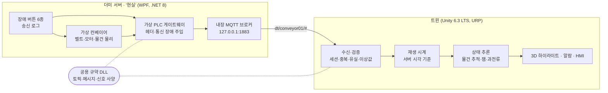

# Unity Conveyor Digital Twin

벨트 컨베이어 1대의 디지털 트윈입니다. 제조사 CAD를 가져와 3D 모델을 만들고, 가상 설비가 MQTT로 보내는 원시 신호를 받아
**현실에서 일어나는 일을 그대로 비추고, 신호 조합으로 이상을 추론해 운전자에게 알립니다.**

게임 클라이언트 개발자가 디지털 트윈 개발에 적응할 수 있는지 직접 보여주기 위한 포트폴리오입니다.
게임 개발에는 없던 세 가지, **CAD 임포트 · 외부 데이터 연동 · HMI와 배포**를 처음부터 끝까지 한 바퀴 구현했습니다.

> 📺 시연 영상: (15일 차에 추가)
>
> 📦 실행 빌드: Windows 10/11 64비트. `ConveyorTwin.exe` 하나만 실행하면 서버까지 자동으로 뜹니다. ([실행 방법](#실행-방법))

<!-- 스크린샷: docs/images/twin.png -->

---

## 무엇을 보여주는가

| 영역 | 구현 | 근거 |
| --- | --- | --- |
| **CAD 임포트** | mk GUF-P 2000 STEP(311부품) → FreeCAD 명령줄 스크립트 → glb → Unity. 볼트·너트 225개 제거, 역할별 7노드 병합, 삼각형 77.5만 → 9.9만 | [CAD 파이프라인](docs/cad-pipeline.md), [`export_conveyor.py`](tools/cad/export_conveyor.py) |
| **외부 데이터 연동** | MQTT(QoS·Retained·Last Will), 세션·순번 헤더, 서버 시각 기준 재생, 중복·유실·이상값·끊김 검증 | [통신 규약](docs/protocol.md), [아키텍처](docs/architecture.md) |
| **상태 추론** | 서버는 판단을 보내지 않음. 광전 센서 엣지 FIFO 추적 + 이동 거리로 잼 판단, 전류 상승으로 교차 확인 | [`ItemTracker.cs`](Twin/Assets/Scripts/Twin/ItemTracker.cs) |
| **HMI** | ISA-101 원칙(정상은 회색, 색은 이상에만), ISA-18.2식 알람(발생·해소·확인), 부품별 셰이더 하이라이트 | [Twin README](Twin/README.md), [`StatusLit.shader`](Twin/Assets/Shaders/StatusLit.shader) |
| **배포** | 트윈 + self-contained 서버 단일 exe, 서버 자동 실행·복구. 클린 PC(Windows 샌드박스)에서 실행 확인 | [배포 빌드](Twin/README.md#배포-빌드-13일-차) |

## 구조



부품별 책임, 메시지가 화면에 반영되는 경로, 잼 판단 순서도는 [docs/architecture.md](docs/architecture.md)에 있습니다.

## 설계 원칙

| 원칙 | 의미 | 구현에서 드러나는 곳 |
| --- | --- | --- |
| **트윈은 현실의 거울** | 데이터의 주인은 현실(서버). 트윈은 값을 만들거나 고치지 않는다 | 데이터가 끊기면 마지막 데이터 끝에서 멈춰 기다림 (외삽 안 함). 출구 감지 전의 박스는 출구 센서 앞에서 대기 |
| **서버는 원시 신호만** | "잼" 같은 판단은 보내지 않는다 | 센서 엣지·속도·전류만 받아 트윈이 잼·과전류를 추론 |
| **장애는 현실 쪽에서** | 장애 버튼은 서버에 있고 트윈은 대응만 한다 | 서버가 꺼지면 트윈이 몰래 되살리지 않고 운전자에게 묻는다 |
| **믿되 맹신하지 않는다** | 순서·중복·이상값·끊김을 트윈이 스스로 검증 | seq 중복·유실 검사, 재정렬, 측정 범위·quality 검사, stale, 출구 짝의 물리적 타당성 검사 |

## 장애 시나리오

서버 창의 버튼으로 장애를 일으키면 트윈이 대응합니다. 서버의 송신 로그("보낸 것")와 트윈 화면("받은 것")을 나란히 비교할 수 있습니다.

| 서버 버튼 | 서버에서 일어나는 일 | 트윈의 대응 |
| --- | --- | --- |
| 연결 끊김 | 소켓 강제 종료 → 브로커가 Last Will(`online: false`) 발행 | 설비 오프라인 알람, 화면 회색조. 복구되면 유실 구간을 인지하고 물건 추적 재동기화 |
| 전송 지연 3초 | 모든 메시지를 3초 늦게, 순서는 유지 | 화면을 서버 시각 기준으로 3초 늦게 재생 (이동 거리 보존)하고 "화면은 3초 전 상태" 표시. 해제되면 배속 재생으로 따라잡음 |
| 순서 뒤섞기 | 메시지별 0~250ms 지터 + 5% 중복 재전송 | 300ms 재생 지연 안에서 `ts` 순 정렬, 중복·과거 `seq` 폐기. 화면 흔들림 없음 |
| 이상값 송신 | 온도 999.9(측정 범위 밖), 전류 `quality: bad` | 값 거부, 마지막 정상값 유지 + 경고. 통신 문제(stale)와 구분해 알람 중복 방지 |
| 물건 걸림 | 박스가 멈추고 뒤 박스가 쌓임, 벨트는 미끄러지며 계속 돎, 전류 +1.2A | 과전류 경고 → 잼 중대 알람, 벨트·박스 빨강 맥동 |
| 모터 정지 | `state/run = fault`, 속도 0 | 모터·제어 박스 빨강, 벨트 정지, 잼 판단 보류 |

## 통신 규약 요약

토픽 `dt/{deviceId}/{category}/{signal}`, JSON(camelCase). 모든 데이터 메시지에 `sid`(세션), `seq`(토픽별 순번), `ts`(발행 시각 ms)가 붙습니다.

| 토픽 | 내용 | 주기 | QoS | Retained |
| --- | --- | --- | --- | --- |
| `status` | 연결 상태 (Last Will 대상) | 변경 시 | 1 | O |
| `state/run` | 가동 상태 `running`·`stopped`·`fault` | 변경 시 | 1 | O |
| `telemetry/belt_speed`·`motor_current` | 벨트 속도(m/s), 모터 전류(A) | 500ms | 0 | O |
| `telemetry/motor_temp` | 모터 온도(°C) | 1000ms | 0 | O |
| `telemetry/load_weight` | 입구 로드셀 무게(kg) | 물건 통과 시 | 1 | X |
| `sensor/entry`·`sensor/exit` | 광전 센서 엣지 `blocked` | 엣지 발생 시 | 1 | **X** |

```json
{ "sid": "a1b2c3", "seq": 57, "ts": 1792886400456, "blocked": true }
```

- 주기 측정값은 하나쯤 잃어도 되므로 QoS 0, 재접속 즉시 화면을 복원하도록 Retained.
- 센서 엣지는 하나라도 놓치면 물건 추적이 틀어지므로 QoS 1, 재접속 때 과거 엣지가 다시 오면 물건이 생겨나므로 Retained 금지.

전체 규약, 트윈 수신 규칙, 설비 치수는 [docs/protocol.md](docs/protocol.md)에 있습니다.

## 실행 방법

### 빌드 받아 실행

1. `ConveyorTwin` 폴더의 `ConveyorTwin.exe`를 실행합니다. 더미 서버가 자동으로 뜹니다 (`Server/ConveyorTwin.DummyServer.exe`).
2. 서버 창의 **장애 주입** 버튼을 눌러 보세요. 다시 누르면 복구됩니다.
3. 트윈 오른쪽 위 **진단** 버튼은 수신 상세(지연, 재정렬, 폐기 건수)를 보여줍니다.

별도 설치는 필요 없습니다. 통신은 PC 안(127.0.0.1)에서만 이루어집니다.

### 소스에서 빌드

필요한 것: .NET 8 SDK, Unity 6000.3.20f1 (Unity 6.3 LTS), FreeCAD 1.1 (CAD 변환), mk GUF-P 2000 STEP 파일 ([받는 방법](cad/README.md))

1. 서버 빌드 + Shared·MQTTnet DLL을 Unity로 복사: `dotnet build src`
2. STEP을 `cad/`에 두고 glb 변환: `"<FreeCAD>/bin/FreeCADCmd.exe" tools/cad/export_conveyor.py` (결과가 `Twin/Assets/ThirdParty/Cad`로 복사됨)
3. Unity로 `Twin` 폴더를 열고 메뉴 **Tools/Twin/Setup Scene** 실행 (씬·머티리얼·한글 폰트 에셋 구성).
4. Play. 서버가 없으면 자동으로 실행됩니다. 서버만 따로 띄우려면 `dotnet run --project src/DummyServer` 또는 `src/unity-conveyor-digital-twin.sln`에서 F5.
5. 배포 빌드: 메뉴 **Tools/Twin/Build Release** → `dist/ConveyorTwin/`.

CAD 원본·변환 메시·폰트 에셋은 저장소에 없으므로 2~3단계가 필요합니다.

## 저장소 구성

| 폴더 | 내용 |
| --- | --- |
| [`src/Shared`](src/Shared) | 토픽·메시지·신호 사양·설비 치수 (netstandard2.1, 서버·트윈 공용, 외부 의존성 없음) |
| [`src/DummyServer`](src/DummyServer) | 가상 설비 + 내장 MQTT 브로커 + 장애 버튼 + 송신 로그 (WPF) |
| [`src/UnityPlugins`](src/UnityPlugins) | Unity용 MQTTnet(netstandard) DLL을 NuGet에서 받아 복사하는 빌드 전용 프로젝트 |
| [`Twin`](Twin) | Unity 트윈: 수신·검증·재생·추론·알람·셰이더·HMI·서버 실행·빌드 |
| [`tools/cad`](tools/cad) | STEP → glb 변환·점검 스크립트 (FreeCAD) |
| [`tools/build`](tools/build) | Windows 샌드박스 클린 PC 테스트 |
| [`docs`](docs) | [아키텍처](docs/architecture.md), [통신 규약](docs/protocol.md), [CAD 파이프라인](docs/cad-pipeline.md) |

## 게임 개발과 달랐던 점

| | 게임 클라이언트 | 디지털 트윈 |
| --- | --- | --- |
| 데이터의 주인 | 클라이언트가 상태를 만들고 서버가 검증 | **현실이 주인.** 트윈은 값을 만들지 않고 추론만 한다 |
| 데이터가 비면 | 예측·보간으로 자연스럽게 메운다 | 메우지 않고 **"모른다"를 보여준다** (회색조, 끊긴 추세선, 화면 지연 표시) |
| 이상 표현 | 연출 (이펙트, 사운드) | **알람 관리 규칙** (등급, 발생·해소는 조건이, 확인은 사람이, 중복 알람 금지) |
| UI 색 | 화려할수록 좋음 | 정상은 회색, **색은 이상에만** (ISA-101) |
| 에셋 | UV·머티리얼·LOD가 갖춰진 게임용 모델 | CAD는 B-rep, UV·머티리얼 없음, 볼트까지 들어 있음 → 변환 파이프라인과 UV 없는 셰이더 |
| 라이선스 | 구매한 에셋 | 제조사 CAD는 재배포 금지 → 원본 대신 **변환 절차를 스크립트로** 남김 |

## CAD 데이터 출처와 라이선스

컨베이어 모델은 [mk Technology Group](https://www.mk-group.com)의 벨트 컨베이어 **GUF-P 2000** CAD 데이터(STEP)를 변환한 것입니다.
제조사 이용 조건에 따라 원본과 변환 메시(glb), 이를 포함한 빌드는 이 저장소에 넣지 않았습니다.
받는 방법과 변환 절차는 [cad/README.md](cad/README.md), [docs/cad-pipeline.md](docs/cad-pipeline.md)에 있습니다.

그 밖의 사용 소프트웨어: [MQTTnet](https://github.com/dotnet/MQTTnet) (MIT), Newtonsoft.Json (MIT), Unity glTFast (Unity Companion License), FreeCAD (LGPL, 변환 도구로만 사용).
HMI 한글은 Windows 기본 글꼴(맑은 고딕)을 실행 시 참조하며 글꼴 파일을 포함하지 않습니다.

## 로드맵

- [x] **1단계**: 컨베이어 1대, CAD 파이프라인, MQTT 연동, 장애 6종 대응, 알람·HMI, 배포
- [ ] **2단계**: ABB 로봇 셀 추가, OPC UA 연동 검토
