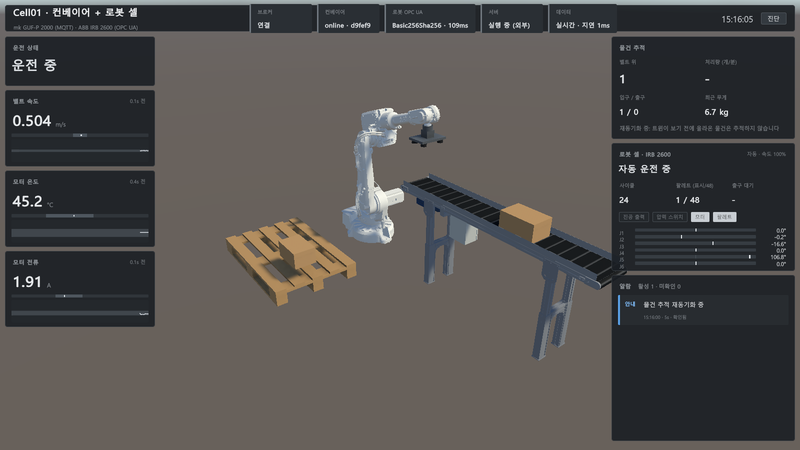

# Twin (Unity 6 LTS, URP)

Unity 6000.3.20f1 (Unity 6.3 LTS), Universal 3D 템플릿.

## 새로 받은 PC에서 여는 순서

1. 저장소 루트에서 `dotnet build src` 실행. 아래 두 DLL이 `Assets/Plugins/`로 복사된다 (둘 다 빌드 산출물이라 커밋하지 않음).
   - `Plugins/Shared/ConveyorTwin.Shared.dll`: 토픽·페이로드 규약 (`src/Shared`)
   - `Plugins/MQTTnet/MQTTnet.dll`: MQTTnet 4.3.7 netstandard2.1 (`src/UnityPlugins`가 NuGet에서 받음)
2. CAD glb 생성: `tools/cad/export_conveyor.py` ([docs/cad-pipeline.md](../docs/cad-pipeline.md)). `Assets/ThirdParty/Cad/conveyor.glb`로 복사된다.
3. Unity로 이 폴더를 열고 메뉴 `Tools/Twin/Setup Scene` 실행 → `Assets/Scenes/Twin.unity` 생성.
4. 더미 서버 실행 (`dotnet run --project src/DummyServer` 또는 VS에서 F5) 후 Play.

패키지: `com.unity.cloud.gltfast`, `com.unity.nuget.newtonsoft-json` (manifest.json에 기록됨).

## 스크립트 구성 (`Assets/Scripts/Twin`)

| 파일 | 역할 |
| --- | --- |
| `MqttLink.cs` | 브로커 접속·구독, 1초 간격 재접속. 수신은 스레드 풀에서 큐에만 넣는다 |
| `MessageGate.cs` | sid 변경 감지(서버 재시작), 같은 세션의 중복·과거 seq 폐기 |
| `ConveyorTwinController.cs` | 메인 스레드에서 메시지 해석, 측정값 보관, 드럼 회전, 물건 배치 |
| `ItemTracker.cs` | 센서 엣지 FIFO로 물건 추적, 위치 추정과 출구 보정 |
| `TwinAlarms.cs` | 알람 관리: 등급(중대·경고·안내), 발생·해소·확인 상태 전이, 채터링 방지 |
| `TwinVisuals.cs` | CAD 노드별 상태 셰이더 머티리얼, 상태별 하이라이트, 벨트 표면 흐름 |
| `TwinHud.cs` | 개발용 텍스트 HUD (HMI의 "진단" 버튼으로 켬) |
| `ServerLauncher.cs` | 시작 시 브로커가 없으면 더미 서버 exe를 찾아 실행, 운전자 요청 시 재실행 |
| `Hmi/TwinHmi.cs`, `Hmi/Sparkline.cs` | 운전자용 HMI 대시보드 (UI Toolkit), 60초 추세선 |
| `../../UI/TwinHmi.uxml`, `TwinHmi.uss` | HMI 레이아웃과 스타일 |
| `OpcUa/RobotOpcUaLink.cs`, `OpcUa/RobotGate.cs`, `OpcUa/MonoTcpTransport.cs` | (2단계) 로봇 OPC UA 접속·인증서 발급·재접속, 값 검사, Mono용 소켓 바인딩 ([docs/robot-opcua.md](../docs/robot-opcua.md)) |
| `Robot/RobotTwin.cs` | (2단계) 로봇 미러: 관절 재생, 박스 인계, 장애 추론·알람·하이라이트 ([docs/robot-cell.md](../docs/robot-cell.md), [docs/robot-faults.md](../docs/robot-faults.md)) |
| `../../Shaders/StatusLit.shader` | URP 셰이더: 주광원·그림자·환경광, 맥동 하이라이트 + 림, 오프라인 회색조, UV 없는 벨트 줄무늬 |

## 트윈이 하는 추정

트윈은 값을 만들지 않는다. 신호 사이를 채워야 하는 값만 받은 신호로 추정하고, 다음 신호로 보정한다.

| 추정 | 근거 신호 | 보정 |
| --- | --- | --- |
| 물건 위치 | 입구 감지 시각 + 벨트 속도 적분 (재생 시계 기준) | 출구 감지 시 앞단을 출구 센서 위치로 맞춤 (HUD "출구보정") |
| 물건 길이 | 입구 센서가 가려진 시간 × 속도 | - |
| 드럼 회전 | 벨트 속도 / 벨트 외경 반지름(0.0275m) | - |

- 출구 감지 전의 물건은 출구 센서 앞에서 기다린다. 확인되지 않은 이동을 지어내지 않기 위해서이며, 잼 판단의 기반이 된다.
- 서버 sid가 바뀌거나, 설비·브로커 연결이 복구되면 그 사이 엣지를 놓쳤으므로 물건 추적을 재동기화한다.

## 재생 시계 (서버 시각 기준 재생)

화면은 트윈의 시계가 아니라 **서버 시각(`ts`)을 300ms 늦게 따라가는 재생 시계**로 움직인다. 게임 네트코드의 스냅샷 보간과 같은 개념이다.

- 목표 재생 시각 = 현재 시각 - 기준 지연 - 300ms. 기준 지연은 최근 1.5초 지연의 **최솟값**이라
  메시지마다 다른 지터(순서 뒤섞기)에는 흔들리지 않고, 지연 자체가 바뀌면 따라간다.
- 재생 시각은 목표로 순간이동하지 않고 배속을 조절해 따라간다 (뒤처지면 최대 3배속, 앞서면 느리게, 뒤로는 가지 않음).
  예: 전송 지연을 끄면 밀린 3초를 약 1.5초간 빨리 감아 실시간으로 돌아온다. 이때 HUD에 "▶▶ 따라잡는 중 ×N"을 표시해
  화면 속도가 실제 설비 속도로 오해되지 않게 한다.
- 데이터가 끊기면 최신 `ts` + 1초에서 멈춰 기다리고, 늦은 데이터가 오면 그 구간을 이어서 재생한다.
- 실제 수신 기록으로 60fps 재생을 재현해 비교한 결과 (순서 뒤섞기 10초 구간):
  최신 메시지 기준 방식은 프레임의 11%가 멈추고 최대 234ms씩 몰아갔고(박스가 앞뒤로 흔들려 보임),
  최솟값 기준 + 배속 조절 방식은 멈춤 0%, 프레임당 진행량 편차 0.3ms였다.
  전송 지연을 끌 때도 2.9초 순간이동 대신 3배속으로 따라잡는다.
  전송 지연 중에도 벨트가 움직인 거리를 잃지 않으며, 화면은 지연만큼 늦게 보인다 (HUD "화면 N초 전 상태").
- 지연만큼 앞으로 당겨 "지금"을 예측해 그리지 않는다. 받지 못한 구간에 잼이 났을 수도 있기 때문이다.
- 이동에는 재생 시각 당시의 속도 샘플을 쓴다. 센서 이벤트도 재생 시각이 그 `ts`에 닿을 때 적용하므로
  300ms 재생 지연이 그대로 재정렬 버퍼 역할을 한다.
- 잼 판단 거리도 재생 시계로 재므로, 모터 정지·전송 지연·연결 끊김 중에는 판단이 진행되지 않는다.

## 상태 하이라이트와 알람 (10일 차)

| 상태 | 알람 | 3D 표현 |
| --- | --- | --- |
| 브로커 끊김·설비 오프라인 | 중대 | 설비 전체 회색조 (보이는 값을 믿을 수 없음) + 제어 박스 주황 점멸 |
| 모터 정지 (fault) | 중대 | 감속 모터·제어 박스 빨강 빠른 맥동 |
| 잼 | 중대 | 벨트 빨강 맥동, 걸린 박스 빨강 맥동 |
| 과전류(> 3.0A)·과열(> 70°C)·모터 신호 이상값 | 경고 | 감속 모터 주황 맥동 |
| 신호 stale | 경고 | 속도 stale이면 벨트 노랑 |
| 화면 지연 > 1초 | 경고 | HUD 표시 |
| 추적 재동기화 | 안내 | HUD 표시 |

알람은 산업 HMI 알람 관리(ISA-18.2)의 기본 개념을 따른다.
- **발생·해소는 조건이 결정한다.** 사람이 끌 수 없다. 조건이 1초 연속으로 사라져야 해소한다 (채터링 방지).
- **확인(acknowledge)은 "봤다"는 표시일 뿐이다.** 활성 알람은 확인해도 남고, 해소됐어도 확인하지 않은 알람은 목록에 남는다.
- **같은 원인으로 알람을 두 번 띄우지 않는다.** 이상값은 도착은 하므로 stale이 아니다 (센서 문제와 통신 문제를 구분).
- 잼과 과전류는 독립된 근거라 함께 뜬다. 전류 상승이 잼보다 먼저 떠서 잼 판단을 뒷받침한다.

벨트 표면은 CAD에 UV가 없으므로, 셰이더가 오브젝트 공간 위치에서 **벨트 루프를 따라 잰 거리**를 계산해 줄무늬를 그린다
(윗면 → 구동 드럼 → 아랫면 → 아이들 드럼). 이동량은 재생 시계로 적분한 벨트 이동 거리라서 박스와 벨트 표면이 같은 속도로 움직인다.

## HMI 대시보드 (11~12일 차)

UI Toolkit으로 만든 운전자 화면. 가운데는 비워 3D 트윈이 보이게 하고 좌우에 값과 알람을 둔다.
ISA-101(고성능 HMI) 원칙에 따라 **정상은 회색, 색은 이상 상태에만** 쓴다.

| 영역 | 내용 |
| --- | --- |
| 상단 칩 | 브로커(연결·끊김), 설비(online·offline), 서버(외부 실행·자동 실행·응답 없음·꺼짐 + 실행 버튼), 데이터(실시간·N초 전·따라잡는 중) |
| 왼쪽 | 운전 상태, 속도·온도·전류: 큰 숫자 + 정상 범위 띠가 있는 막대 + 60초 추세 (정상 범위를 벗어난 구간은 주황) |
| 오른쪽 | 물건 추적(벨트 위, 처리량 개/분, 입·출구, 최근 무게), 알람 목록(등급 색, 미확인 점멸, 확인 버튼) |
| 가운데 배너 | 화면을 그대로 믿으면 안 되는 상황: 브로커 끊김, 설비 오프라인, 잼, 고장 정지, 따라잡는 중, 화면 지연 |

### 로봇 셀 통합 (2단계 8일 차)



| 영역 | 내용 |
| --- | --- |
| 상단 칩 "로봇 OPC UA" | 연결(보안 정책 · 관절각 지연 ms), 인증서 발급 중, 끊김·재접속 중, 연결 불가 |
| 오른쪽 "로봇 셀" 카드 | 상태 한 줄(자동 운전 중·프로그램 정지·모터 OFF·비상정지·흡착 실패·확인 불가), 모드·속도, 사이클, 팔레트(트윈이 표시한 박스 / 48), 출구 대기 시간, IO 4개(진공 출력·압력 스위치·모터·팔레트 — 켜짐은 밝은 회색, 이상만 빨강), 관절 6개(가동 범위 막대, 0° 선, 한계 10° 안이면 주황) |
| 알람 목록 | 컨베이어와 한 목록 (RobotTwin이 `AppendConditions`로 더함). 행이 많으면 5개까지, 넘쳐도 행이 겹치지 않음 |
| 가운데 배너 | 컨베이어 문제가 없을 때 로봇 통신 끊김, 비상정지, 흡착 실패, 관절각 Bad |

- 카드에는 원시 신호만 그대로 보이고, "흡착 실패"처럼 신호 조합으로 내린 판단은 알람·배너가 보인다.
- 통신 끊김·관절각 Bad 동안 카드 숫자는 흐리게(마지막 수신 값), 3D 로봇은 회색조다.
- 진단 HUD에는 로봇 링크 상태, RobotGate 검증 통계(통과·Bad·과거·미래·범위 밖·중복), 집기 오차, 로봇 경고가 추가됐다.
- HMI 포함 캡처: 플레이 점검(`TwinPlayCheck`)이 UI Toolkit 패널을 잠시 렌더 텍스처로 그려 3D 화면 위에 합성한다 (`dist/playcheck/hmi_*.png`).

- 값을 믿을 수 없을 때(stale, 오프라인)는 숫자를 흐리게 하고 추세선을 끊는다. 끊긴 구간을 그럴듯한 선으로 메우지 않는다.
- 한글은 OS에 설치된 맑은 고딕으로 런타임에 폰트 에셋을 만든다 (`FontAsset.CreateFontAsset`). 폰트 파일을 저장소에 넣지 않으며, Windows 빌드만 하므로 문제없다.

## 서버 자동 실행과 복구

- 시작 시 `127.0.0.1:1883`에 응답이 없으면 더미 서버 exe를 찾아 실행한다.
  찾는 순서: 환경 변수 `CONVEYOR_SERVER_EXE` → 빌드 폴더의 `Server/` → `src/DummyServer/bin/Release/.../publish` → `bin/Release` → `bin/Debug`.
- 실행 중 서버가 사라지면 **스스로 다시 띄우지 않는다.** 브로커가 5초 넘게 끊기고 서버 프로세스도 없으면 다이얼로그로 운전자에게 묻는다
  ([나중에]는 60초 동안 다시 묻지 않음). 상단 서버 칩의 [실행] 버튼으로도 바로 실행할 수 있다.
  서버는 "현실" 역할이라 트윈이 몰래 되살리면 장애를 감추게 되기 때문이다. 실제 현장이라면 트윈은 설비를 재시작하지 않고 점검을 요청한다 → 이 기능은 **시연 편의용**.
- 프로세스는 있는데 응답이 없으면 실행을 권하지 않는다 (같은 포트로 두 번째 서버가 뜨면 충돌). "응답 없음 · 서버 창 확인"으로 안내한다.
- 트윈을 닫아도 서버는 끄지 않는다. 트윈을 다시 켜면 같은 세션에 이어 붙는다.

## 배포 빌드 (13일 차)

메뉴 `Tools/Twin/Build Release` (`Assets/Editor/TwinBuild.cs`) 하나로 저장소 루트의 `dist/ConveyorTwin/`을 만든다.

```
dist/ConveyorTwin/
  ConveyorTwin.exe, ConveyorTwin_Data/, UnityPlayer.dll, MonoBleedingEdge/, D3D12/   트윈 (Unity, Mono, 약 102MB)
  Server/ConveyorTwin.DummyServer.exe                                              더미 서버 (self-contained 단일 exe, 압축 약 68MB)
  실행방법.txt
```

- 받는 사람은 `ConveyorTwin.exe`만 실행하면 된다. `ServerLauncher`가 `Server/`에서 서버를 찾아 띄운다. .NET 설치는 필요 없다.
- 명령줄 빌드 (에디터를 닫은 상태):
  `Unity.exe -batchmode -quit -projectPath Twin -executeMethod ConveyorTwin.EditorTools.TwinBuild.BuildReleaseBatch -logFile build.log`
- 사전 조건: CAD glb와 한글 폰트 에셋(Setup Scene이 생성)이 있어야 한다. 없으면 빌드가 멈추고 이유를 알려 준다.
- `dist/`는 git에서 제외한다. **CAD 변환 메시가 들어 있으므로 공개 배포 전에 mk CAD 이용 조건을 확인해야 한다.**

클린 PC 테스트: `tools/build/sandbox_test.ps1`이 Windows 샌드박스(설치 프로그램이 없는 깨끗한 Windows)에
빌드 폴더를 읽기 전용으로 연결하고 네트워크를 끈 채 띄운다. 샌드박스 기능은 `Windows 기능 켜기/끄기`에서 켠다 (관리자·재부팅 필요).

2026-10-21 확인 결과 (.NET·Unity·VC++ 런타임이 없는 샌드박스, 네트워크 끔, 빌드 폴더 읽기 전용):
`ConveyorTwin.exe` 실행 → 서버 자동 실행, HMI 한글 표시, 3D 모델·벨트 흐름·박스 이동, 장애 버튼 반응 모두 정상.
즉 배포물이 별도 설치 없이 실행되고, 자기 폴더에 쓰지 않으며, 외부 네트워크 없이 동작한다.

빌드에서만 생긴 문제와 해결:

| 증상 | 원인 | 해결 |
| --- | --- | --- |
| 빌드에서만 벨트 줄무늬가 없음 | `shader_feature`는 빌드에 포함된 머티리얼 에셋이 쓰는 키워드 변형만 남긴다. 벨트 키워드는 런타임에 켜서 변형이 스트리핑됨 | `multi_compile_local`로 변경 |
| `*_BurstDebugInformation_DoNotShip` 폴더 | Burst(Collections 패키지 의존성)의 디버그 정보 | 빌드 스크립트가 삭제 |
| (예방) 역직렬화 실패 가능성 | 관리 코드 스트리핑이 Newtonsoft·MQTTnet이 리플렉션으로 쓰는 코드를 지울 수 있음 | `Assets/link.xml`로 Shared·MQTTnet 보존 |

## 좌표

반송 방향 = Unity +Z (입구 센서 = `Drum_Tail`, 출구 센서 = `Drum_Head`). 센서 위치와 방향은 CAD 드럼 위치에서 런타임에 읽는다.
