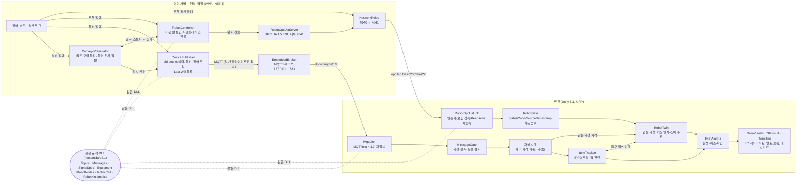
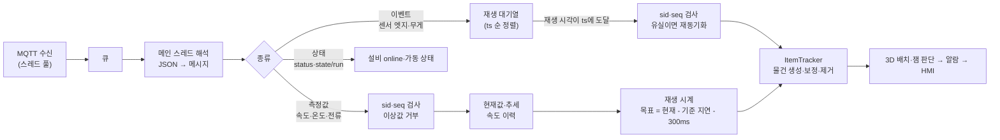
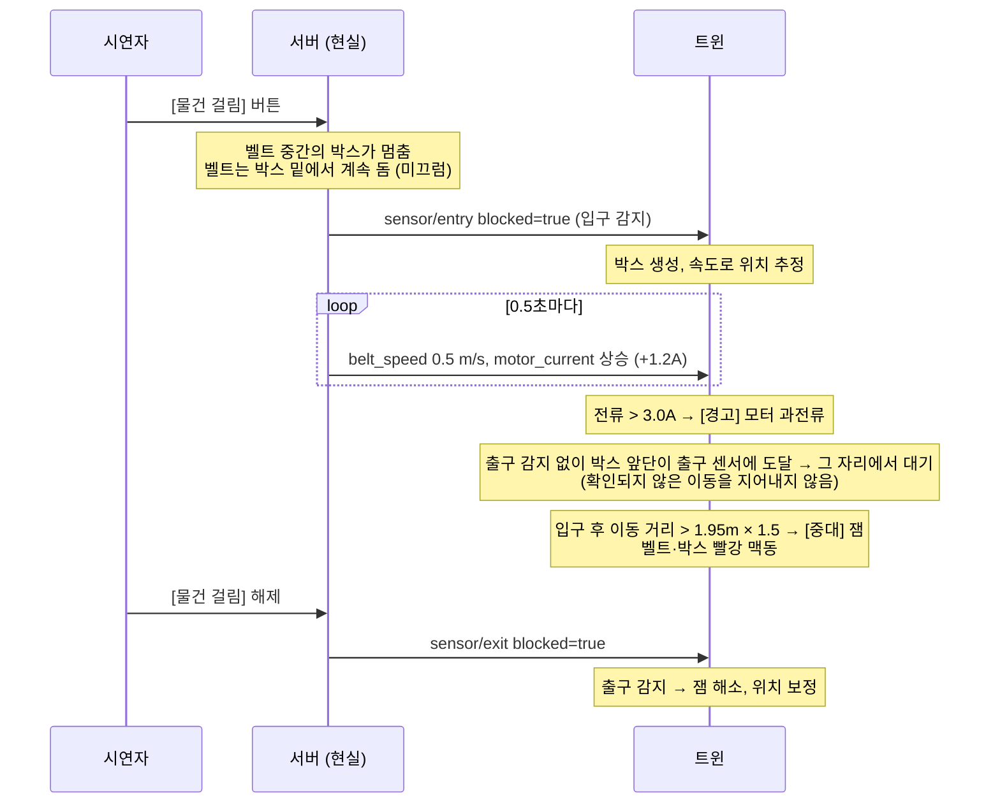
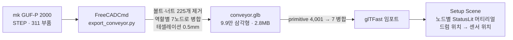
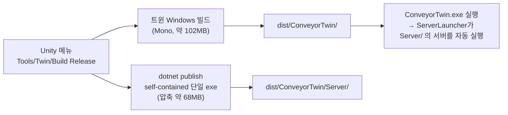
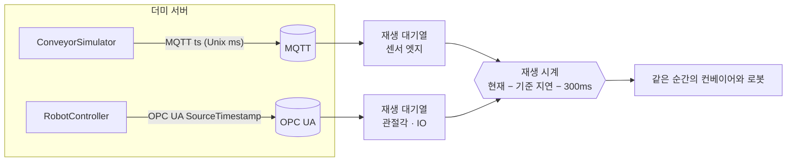
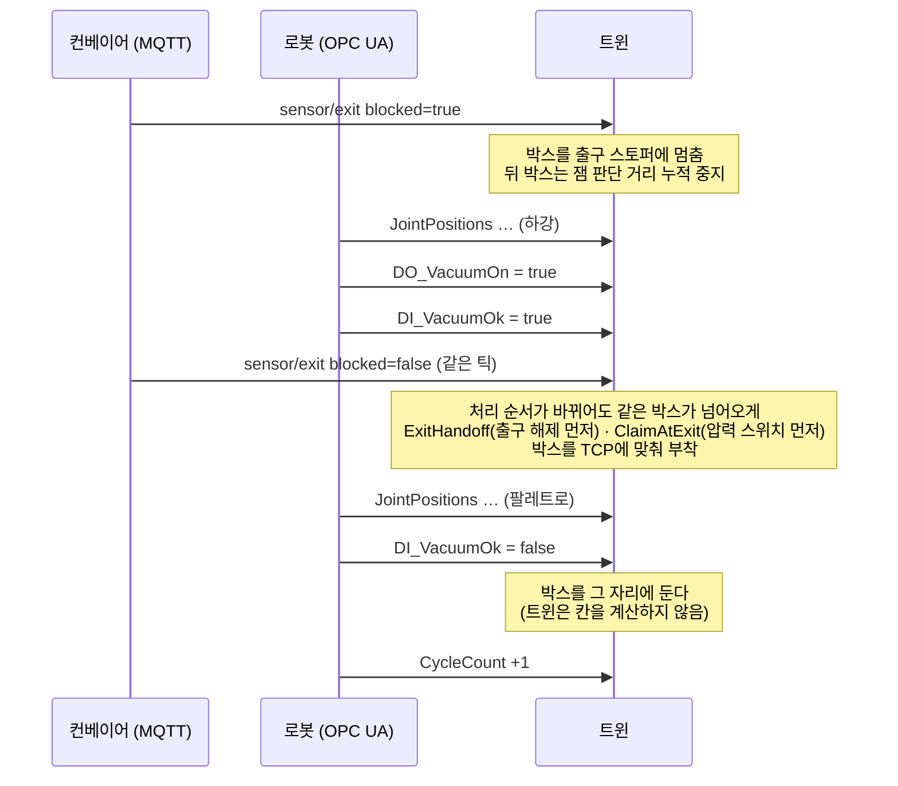
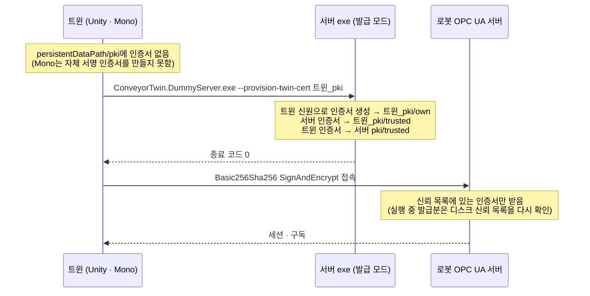

# 아키텍처

벨트 컨베이어 + ABB 로봇 팔레타이징 셀의 디지털 트윈이 어떤 부품으로 이루어지고, 데이터가 어떻게 흐르는지 정리한 문서입니다.
1~6절은 1단계(컨베이어, MQTT), 7~10절은 2단계(로봇 셀, OPC UA)입니다.
부품별 상세는 각 폴더 README와 [통신 규약](protocol.md), [로봇 OPC UA](robot-opcua.md), [CAD 파이프라인](cad-pipeline.md)에 있습니다.

## 1. 전체 구조

트윈의 `ServerLauncher`는 시작 시 브로커가 없으면 서버 exe를 실행합니다 (6절).

- **데이터의 주인은 서버("현실")입니다.** 트윈은 값을 만들거나 고치지 않고, 받은 원시 신호로 상태를 추론합니다.
- **서버와 트윈은 같은 규약 DLL을 씁니다.** 토픽 이름, 메시지 형식, 신호별 주기·측정 범위·QoS, 벨트 길이가 한곳에 있어
  서버는 이것으로 값을 만들고 트윈은 같은 값으로 검증합니다 (`SignalSpec`: 서버는 주기대로 발행, 트윈은 주기 × 3 동안 안 오면 stale).
- **장애는 서버에서 일어납니다.** 통신 장애는 "통신 경로"인 `DevicePublisher`가, 설비 장애는 "현실"인 `ConveyorSimulator`가 만듭니다.

## 2. 부품과 책임

| 부품 | 위치 | 책임 |
| --- | --- | --- |
| `ConveyorSimulator` | `src/DummyServer/Simulation` | 20ms 주기 물리: 벨트 속도, 모터 전류(하중 비례), 온도(1차 지연), 물건 위치(속도 적분). 센서가 볼 원시 신호만 발행 |
| `DevicePublisher` | `src/DummyServer/Mqtt` | 헤더 부여, JSON 직렬화, QoS·Retained 적용. 연결 끊김(소켓 강제 종료), 지연(순서 보존 큐), 뒤섞기(메시지별 지터) 주입 |
| `EmbeddedBroker` | `src/DummyServer/Mqtt` | 루프백 전용 브로커. 접속 클라이언트 표시 |
| `Shared` | `src/Shared` | 토픽·메시지·신호 사양·설비 치수. 외부 의존성 없음 (Unity와 .NET 8 양쪽에서 참조) |
| `MqttLink` | `Twin/.../Twin` | 구독·재접속. 수신 콜백(스레드 풀)은 큐에만 넣고 해석은 메인 스레드 |
| `MessageGate` | `Twin/.../Twin` | sid 변경(서버 재시작) 감지, 같은 세션의 중복·과거 seq 폐기, 엣지 seq 건너뜀(유실) 감지 |
| `ConveyorTwinController` | `Twin/.../Twin` | 재생 시계, 이상값 거부, stale 판정, 알람 조건 판단, 드럼 회전 |
| `ItemTracker` | `Twin/.../Twin` | 센서 엣지 FIFO로 물건 추적, 위치·길이 추정, 출구 보정, 잼 판단, 재동기화 |
| `TwinAlarms` | `Twin/.../Twin` | 알람 등급과 상태 전이 (발생·해소는 조건이, 확인은 사람이) |
| `TwinVisuals` + `StatusLit.shader` | `Twin/.../Twin`, `Twin/Assets/Shaders` | 부품별 상태 하이라이트, 오프라인 회색조, UV 없는 벨트 표면 흐름 |
| `TwinHmi` | `Twin/.../Twin/Hmi`, `Twin/Assets/UI` | 운전자 대시보드: 연결 상태, 측정값·추세, 물건 추적, 알람 |
| `ServerLauncher` | `Twin/.../Twin` | 시작 시 서버가 없으면 실행. 실행 중 사라지면 운전자에게 묻고 재실행 |
| `RobotController` | `src/DummyServer/Simulation` | (2단계) 가상 로봇 컨트롤러: 출구 스토퍼의 박스를 집어 팔레트 48칸에 적재. 공구 하향 IK + 관절 공간 5차 보간(MoveJ), 진공은 실제 시간으로 형성, 장애 3종 |
| `RobotOpcUaServer`·`RobotNodeManager` | `src/DummyServer/OpcUa` | (2단계) OPC 40010 구조의 주소 공간, 값이 바뀔 때만 갱신, 신뢰 목록 기반 보안, 트윈 인증서 발급 모드 |
| `NetworkRelay` | `src/DummyServer/OpcUa` | (2단계) 로봇 컨트롤러와 트윈 사이 "네트워크". 통신 끊김 장애는 여기만 끊는다 |
| `RobotOpcUaLink` | `Twin/.../Twin/OpcUa` | (2단계) 인증서 준비(없으면 서버 exe로 발급), Basic256Sha256 접속, 구독, KeepAlive로 끊김 감지·재접속, 서버 시작 시각 |
| `RobotGate` | `Twin/.../Twin/OpcUa` | (2단계) StatusCode·SourceTimestamp(과거·미래·중복)·관절 가동 범위 검사, 서버 재시작 감지. MQTT 쪽 `MessageGate`의 OPC UA판 |
| `MonoTcpTransport` | `Twin/.../Twin/OpcUa` | (2단계) Unity(Mono)에서 실패하는 스택의 TCP 접속을 대신하는 opc.tcp 바인딩 |
| `RobotTwin` | `Twin/.../Twin/Robot` | (2단계) 관절각을 재생 시계로 재생, 압력 스위치로 박스 인계, 흡착 실패·출구 대기 추론, 로봇 알람·하이라이트 |

## 3. 메시지 하나가 화면에 반영되기까지

**재생 시계**가 이 구조의 중심입니다. 화면은 트윈의 시계가 아니라 서버 시각(`ts`)을 300ms 늦게 따라가며 재생됩니다.
게임 네트코드의 스냅샷 보간과 같은 개념이지만, 목적이 다릅니다.

| | 게임 (스냅샷 보간) | 이 트윈 |
| --- | --- | --- |
| 목적 | 부드러운 움직임 | **서버에서 일어난 순서 그대로** 재현 |
| 데이터가 끊기면 | 외삽(예측)으로 메움 | 마지막 데이터 끝에서 **멈춰 기다림**. 받지 못한 구간을 지어내지 않음 |
| 늦은 데이터가 오면 | 버림 | 그 구간을 **이어서 재생**하고 따라잡음 (이동 거리 보존) |
| 화면이 늦다는 것 | 숨김 | **표시함** ("화면은 3.0초 전 상태", "따라잡는 중 ×2.4") |

자세한 동작은 [Twin/README.md의 재생 시계](../Twin/README.md#재생-시계-서버-시각-기준-재생) 절에 있습니다.

## 4. 잼 판단 (물건 걸림 장애)

서버는 "잼"이라는 판단을 보내지 않습니다. 트윈이 두 가지 독립된 근거로 추론합니다.

- **이동 거리로 판단합니다.** 규약의 "벨트 길이 / 속도 × 1.5초"와 같지만, 모터 정지·전송 지연 동안에는 벨트가 움직이지 않았으므로 자동으로 빠집니다.
- **과전류가 먼저 뜹니다.** 박스가 벨트에 끌리면 모터 부하가 오르므로, 센서 판단(잼)과 전기 신호(전류)가 같은 사건을 서로 다른 경로로 뒷받침합니다.
- **한계:** 광전 센서가 양 끝에만 있어 박스가 어디서 걸렸는지는 알 수 없습니다. 트윈은 "입구와 출구 사이 어딘가"라는 사실만 압니다.

## 5. CAD에서 화면까지

CAD 노드가 곧 트윈의 표현 단위입니다: `Belt`(흐름·잼), `Drum_Head`/`Drum_Tail`(회전, 원점 = 축), `DriveMotor`(과전류·과열), `ControlBox`(고장 정지·통신), `Frame`, `Legs`.
센서 위치와 반송 방향도 하드코딩하지 않고 CAD 드럼 위치에서 읽습니다. 자세한 내용은 [CAD 파이프라인](cad-pipeline.md).

## 6. 배포

받는 사람은 `ConveyorTwin.exe` 하나만 실행하면 됩니다. .NET 설치가 필요 없고, 통신은 PC 안(127.0.0.1)에서만 이루어집니다.
Windows 샌드박스(설치 프로그램 없음, 네트워크 끔)에서 동작을 확인했습니다.
2단계부터는 `tools/build/sandbox_test.ps1 -Auto`가 샌드박스 안에서 트윈 자체 점검(`-selfcheck`)과 로봇 장애 시나리오를 자동으로 돌리고 결과를 회수합니다.

## 7. 로봇 셀: 두 프로토콜을 한 시계로 (2단계)

MQTT의 `ts`와 OPC UA의 SourceTimestamp는 같은 서버 시계에서 나옵니다. 트윈은 둘을 각자의 대기열에 쌓고 **하나의 재생 시계**로 꺼내므로,
박스가 출구에서 그리퍼로 넘어가는 순간이 두 프로토콜 사이에서 어긋나지 않습니다. 로봇 관절각은 값이 바뀔 때만 오므로,
마지막 샘플 이후에는 그 자세를 유지하는 것이 곧 현실과 같습니다.

| | MQTT (컨베이어) | OPC UA (로봇) |
| --- | --- | --- |
| 데이터 구조 | 토픽 규칙 + JSON (직접 정의) | 서버의 주소 공간을 탐색 (OPC 40010 구조) |
| 시각·신뢰도 | 페이로드 `ts`·`quality` | SourceTimestamp·StatusCode (표준) |
| 세션·순서 | `sid`·`seq` (직접 검증) | 서버 시작 시각, 구독 순번 (스택) |
| 끊김 감지 | Last Will | 세션 KeepAlive |
| 보안 | 없음 (루프백) | 인증서 신뢰 목록 + Basic256Sha256 |

## 8. 박스 인계 (출구 → 그리퍼 → 팔레트)

- 서버는 "지금 무슨 단계"를 보내지 않습니다. 트윈은 출구 센서·진공 출력·압력 스위치·관절각만 보고 박스를 옮깁니다.
- 흡착 실패도 서버가 알리지 않습니다. 진공 출력 ON인데 압력 스위치가 0.5초 넘게 OFF면 트윈이 판단합니다.

## 9. OPC UA 인증서 발급 (첫 실행)

현장에서 GDS(Global Discovery Server)가 장비 인증서를 발급·배포하는 역할을 축소한 형태입니다. 서버 인증서가 바뀌어 신뢰가 깨지면
트윈이 한 번 다시 발급받습니다. Mono의 다른 제약(TCP 접속, RSA-PSS)은 [OPC UA 스파이크](opcua-spike.md)에 있습니다.

## 10. 로봇 장애와 "지어내지 않기"

| 상황 | 트윈이 아는 것 | 트윈이 하는 것 |
| --- | --- | --- |
| 로봇 통신 끊김 | 마지막 수신 자세까지만 | 회색조로 멈춤. 재접속하면 SourceTimestamp가 재접속 이전인 값 = 끊긴 동안 바뀐 값. 그 사이 놓인 박스는 놓이는 순간을 못 봤으므로 관측처럼 그리지 않고, 사이클 수와 적재 레시피로 정한 칸에 **회색 추정 박스**로 구분해 표시 |
| 관절각 StatusCode Bad | 측정을 믿을 수 없음 | 마지막 정상 자세 유지. 그동안 놓인 박스는 멈춘 그리퍼 위치에 두지 않고, 그 칸을 추정 박스로 채움 |

관측과 추정을 나누는 이유: 못 본 박스를 아예 그리지 않으면 그 칸이 비고, 다음 단 박스(관측)가 빈칸 위에 떠 보였다 (사용자 시험에서 발견).
"위층이 있으면 아래층도 있다"는 것은 사이클 수(원시 신호)와 로봇 프로그램의 적재 패턴에서 나오는 사실이므로 그리되,
놓이는 순간을 본 박스와 섞이지 않게 회색으로 그리고 HMI에 "관측+추정"으로 나눠 센다. 관측 박스를 빈칸으로 옮기는 방식은 관측값을 고치는 것이라 쓰지 않았다.
| 비상정지·흡착 실패 | 원시 신호 (EmergencyStop, MotorsOn, 진공 출력·압력 스위치) | 알람·하이라이트. 출구에 박스가 쌓여도 잼으로 오판하지 않음 |

상세와 검증 결과는 [로봇 장애](robot-faults.md)에 있습니다.
