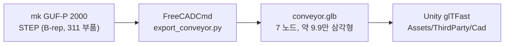

# CAD 파이프라인 (STEP → FreeCAD → glb → Unity)

제조사 CAD 데이터를 Unity 트윈에 넣기까지의 과정입니다.
CAD 원본과 변환 결과는 mk 라이선스상 재배포할 수 없어 저장소에 포함하지 않고, **변환 절차를 스크립트로 남겨 누구나 같은 결과를 재현**할 수 있게 했습니다.



## 1. 준비

| 항목 | 내용 |
| --- | --- |
| CAD 원본 | mk 다운로드 센터에서 GUF-P 2000 STEP을 받아 `cad/`에 둔다 ([cad/README.md](../cad/README.md)). 현재 파일: `MK163596.stp` (mk QuickDesigner, Autodesk Inventor 2015에서 생성) |
| FreeCAD | 1.1.4 (`winget install FreeCAD.FreeCAD`). GUI 없이 `FreeCADCmd.exe`로 실행 |
| Unity | 6000.3.20f1 (Unity 6.3 LTS), URP, `com.unity.cloud.gltfast` 6.20.0 |

Unity의 Asset Transformer(Pixyz)는 유료라서 무료 도구(FreeCAD + glTFast)만으로 구성했다.

## 2. 실행

저장소 루트에서:

```bash
"C:/Users/<user>/AppData/Local/Programs/FreeCAD 1.1/bin/FreeCADCmd.exe" tools/cad/export_conveyor.py
"C:/Users/<user>/AppData/Local/Programs/FreeCAD 1.1/bin/python.exe" -I tools/cad/inspect_glb.py cad/conveyor.glb
```

첫 줄이 `cad/conveyor.glb`를 만들고 `Twin/Assets/ThirdParty/Cad/`로 복사한다. 둘째 줄은 노드, 삼각형 수, UV, 크기를 출력한다.
Unity에서는 메뉴 `Tools/CAD/Check Conveyor Import`로 임포트 결과(서브메시, 축, 드럼 간 거리)를 콘솔에 출력해 확인한다.

## 3. 원본 구조 분석

STEP 조립 트리를 FreeCADCmd로 덤프해 부품 역할을 파악했다. 부품 이름은 대부분 mk 품번이라 크기와 위치로 역할을 판정했다.

| 최상위 조립품 | 역할 |
| --- | --- |
| `K1029003.2000…` | 벨트. 솔리드 하나(면 22개)로 된 루프, 290 × 2005mm |
| `B08.00.001` | 프레임. 1880mm 사이드 프로파일, 벨트 받침판, 크로스바 |
| `B01.00.050` | 구동부. 구동 드럼, 감속 모터 `K301000975`, 속도 조절기 `EREG230AC_0.37` |
| `B80.00.001` | 텐션 쪽 아이들 드럼과 엔드캡(`MK 2600/2601`) |
| `B67.03.002` × 2 | 다리 2세트 |

- `EREG230AC_0.37`은 이름만 보면 모터 같지만 스위치가 달린 **속도 조절기(제어 박스)**다. 실제 모터는 구동 드럼 끝의 감속 모터다.
- STEP에 색 정보는 없다 (전부 단색). 머티리얼은 Unity에서 노드별로 지정한다.
- 부품의 72%(225개)가 볼트·너트·T너트·와셔이고, 이들이 삼각형의 44%를 차지한다.

### FreeCAD STEP 가져오기 설정 (GUI로 열어 볼 때)

| 옵션 | 값 | 이유 |
| --- | --- | --- |
| Mode | Single document | 하나의 glb로 내보내기 위해 |
| Enable STEP Compound merge | 끔 | 켜면 벨트·프레임이 한 형상으로 합쳐짐 |
| Use LinkGroup | 켬 | 조립 계층 유지 |
| Import invisible objects | 끔 | 보조 형상 불필요 |
| Reduce number of objects | 끔 | 부품 구분 유지 |
| Expand compound shape with multiple solids | 켬 | 솔리드 단위로 펼쳐 구조 파악 |
| Ignore instance names | 끔 | 품번 이름이 트리·Unity 계층 이름이 됨 |
| CodePage | No conversion | 파일에 8비트 문자가 없음 (독일어 문자는 STEP 표준 이스케이프 `\X\F6` 등으로 저장됨) |

## 4. 변환 스크립트가 하는 일

1. **체결 부품 제거**: `D*`(DIN 표준품), `34.*`(T너트), 가장 긴 변이 30mm 미만인 `K1*`/`K3*`(캡·와셔). 311개 중 225개 제거.
2. **역할별 병합**: 라벨 접두어 규칙으로 부품을 7개 노드에 나눠 담는다. 시각화·상태 표시 단위가 곧 노드 단위다.

   | 노드 | 트윈에서의 쓰임 |
   | --- | --- |
   | `Belt` | 벨트 흐름 표현, 잼 하이라이트 |
   | `Drum_Head` / `Drum_Tail` | 벨트 속도에 맞춰 회전 (노드 원점 = 드럼 축) |
   | `DriveMotor` | 모터 온도·전류 알람 하이라이트 |
   | `ControlBox` | 모터 fault 표시 |
   | `Frame`, `Legs` | 고정 구조물 |

3. **테셀레이션**: 선형 0.5mm, 각도 0.5rad.
4. **glb 내보내기** 후 **primitive 병합**, Unity 프로젝트로 복사.

## 5. 겪은 문제와 해결

| 문제 | 원인 | 해결 |
| --- | --- | --- |
| 삼각형 77.5만 개 (예상의 8배) | glTF writer는 정밀도 설정을 읽지 않고 형상에 저장된 삼각분할을 그대로 쓴다. `Shape.tessellate()`는 각도 허용치를 지정할 수 없어 곡면이 과분할됨. 삼각분할이 없으면 빈 메시가 나간다 | `MeshPart.meshFromShape(LinearDeflection, AngularDeflection)`로 삼각분할을 미리 채움 → 9.9만 개 |
| primitive 4,001개 | OCCT writer가 B-rep 면 하나마다 primitive를 만든다. glTFast는 이를 서브메시로 가져와 드로우콜이 그만큼 생김 | 머티리얼이 없으므로 스크립트에서 메시별로 primitive를 하나로 병합 (외부 패키지 없이 glb 바이너리 직접 재작성) |
| 드럼 회전 중심 | 형상이 전역 좌표에 있어 노드 원점이 월드 원점 | 드럼 노드에 축 중심 위치를 주고 메시를 반대로 옮겨, 노드 원점이 축 중심이 되게 함 |
| 명령줄 인수 | `FreeCADCmd`는 스크립트 뒤의 인수를 열 파일로 해석 | 경로를 인수로 받지 않고 스크립트 위치 기준으로 결정 |

## 6. 결과 (Unity에서 확인)

| 항목 | 값 |
| --- | --- |
| 노드 / 서브메시 | 7 / 7 |
| 삼각형 | 98,635 |
| glb 크기 | 2.8MB |
| 단위 | 1유닛 = 1m |
| 반송 방향 | Unity +Z (Drum_Tail z = −0.975 → Drum_Head z = +0.975) |
| 드럼 중심 간 거리 | 1.950m → 잼 판단 기준 벨트 길이 ([protocol.md](protocol.md) 6절) |
| 벨트 윗면 / 드럼 축 높이 | y ≈ 0.850 / 0.823 |
| UV / 머티리얼 | 없음 → 벨트 흐름은 오브젝트 공간 기준 셰이더로 표현 |

glTF는 오른손 좌표계, Unity는 왼손 좌표계라 glTFast가 X축을 반전한다. 그래서 구동부와 제어 박스는 Unity에서 +X 쪽에 있다.
