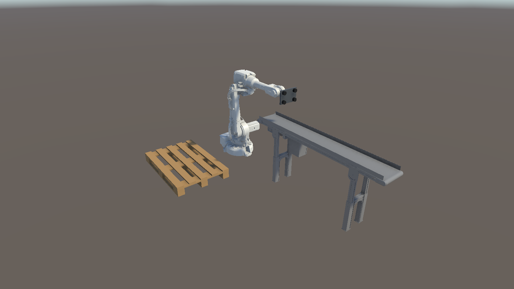

# 로봇 셀 배치 (2단계 2일 차)

컨베이어 출구에서 박스를 집어 옆 팔레트에 3단으로 쌓는 셀. 수치의 원본은 `src/Shared/RobotCell.cs`이고,
서버(4일 차 가상 로봇 컨트롤러)와 트윈이 같은 값을 쓴다.



## 좌표계

`RobotCell`의 좌표는 **로봇 베이스 좌표계**다 — ABB 컨트롤러가 쓰는 base frame과 같다.
원점은 J1 축과 바닥면의 교점, +X는 홈 자세에서 팔이 뻗는 방향(컨베이어 출구 쪽), +Z는 위, 오른손 좌표계, 단위 m.

> 산업용 로봇은 목표 위치를 보통 베이스(또는 작업물) 좌표계로 가르친다. 서버가 이 좌표로 목표를 정하고 관절각으로 바꿔 보내면,
> 트윈은 관절각만 따라 그리면 된다. 그래서 공용 수치를 Unity 좌표가 아니라 로봇 좌표로 둔다.

트윈 씬에서 로봇 베이스는 Unity (0, 0, 1.70)에 있고 팔이 −Z(컨베이어 쪽)를 향한다 (`RobotCellBuilder`).

```
Unity 월드 = (0, 0, 1.70) + (y, z, −x)      // (x, y, z) = 베이스 좌표
```

## 배치

| 항목 | 베이스 좌표 (m) | Unity 월드 (m) | 근거 |
| --- | --- | --- | --- |
| 로봇 베이스 | (0, 0, 0) | (0, 0, 1.70) | 베이스 앞쪽 끝(+275mm)과 컨베이어 끝 사이 약 0.4m 간격 |
| 픽 위치 (박스 윗면 중심) | (0.875, 0, 1.0) | (0, 1.0, 0.825) | 출구 센서(구동 드럼 중심 z=0.975)에 앞단이 닿은 0.30m 박스, 벨트 윗면 0.85 + 박스 0.15 |
| 팔레트 바닥 중심 | (0, −1.0, 0) | (−1.0, 0, 1.70) | 로봇 오른쪽. 컨베이어 구동부(+X)의 반대편 |

- 팔레트: EUR 1200×800×144 (하판·블록·스트링거·상판 프리미티브). 긴 변이 베이스 X(= Unity Z)와 평행.
- 적재: 박스(0.30×0.20×0.15)를 긴 변끼리 맞춰 4 × 4 = 16개/단, 3단 = 48개. 한 단 안에서는 로봇에서 먼 줄부터 채운다
  (그리퍼가 이미 놓인 박스 위를 지나가지 않게). 3단 윗면 높이 0.594m.
- 그리퍼: 진공 흡착식 프리미티브 (어댑터 → 몸체 → 패드 판 → 흡착 컵 4개), 플랜지 면에서 흡착면까지 0.15m. J6 노드 아래 `Gripper/TCP`.

## 점검 (`Tools/Twin/Check Robot Cell`, `Twin/Assets/Editor/RobotCellCheck.cs`)

```bash
Unity.exe -batchmode -quit -projectPath Twin -executeMethod ConveyorTwin.EditorTools.TwinSceneSetup.SetupBatch -logFile setup.log
Unity.exe -batchmode -quit -projectPath Twin -executeMethod ConveyorTwin.EditorTools.RobotCellCheck.CheckBatch -logFile cell-check.log
```

1. 픽 위치를 컨베이어 glb 실측(구동 드럼 위치, 벨트 윗면)과 비교
2. 픽 + 팔레트 48칸 전부에 대해 공구 수직 하향 자세의 해석적 IK(팔꿈치 위, J4 = 0)를 풀어 관절 가동 범위 안인지 확인
3. 그 관절각을 Unity 로봇에 넣고 `TCP` 위치를 목표와 비교 — 관절 규약·그리퍼 길이·배치 변환을 한 번에 검증
4. 개요·픽·먼 칸 적재 자세를 `dist/cellcheck/*.png`로 캡처

여기의 IK는 배치 점검용이다. 트윈 런타임은 IK를 하지 않는다 (원칙 1). 4일 차 서버가 같은 계산으로 목표 관절각을 만든다.

### 결과 (2026-10-26)

| 항목 | 값 |
| --- | --- |
| 픽 위치 vs 컨베이어 실측 | 일치 (0, 1.000, 0.825) |
| 도달 사용률 (J2→손목 / 상완+전완) | 최대 85% (Slot32, 3단의 가장 먼 모서리) |
| 관절 가동 범위 여유 | 최소 20.8° (Slot13의 J3) |
| TCP 오차 | 0.00mm |
| 픽 자세 | (0.0, −6.0, 7.5, 0.0, 88.5, 0.0)° |

관절 가동 범위(ABB 제품 자료): J1 ±180°, J2 −95~+155°, J3 −180~+75°, J4 ±400°, J5 ±120°, J6 ±400°.

## 가상 로봇 컨트롤러 (4일 차, `src/DummyServer/Simulation/RobotController.cs`)

서버가 "현실의 로봇 컨트롤러" 역할로 적재 프로그램 `PalletizeBoxes`를 실행하고, 원시 신호만 OPC UA로 낸다.

### 사이클

| 단계 | 동작 | 나가는 신호 |
| --- | --- | --- |
| ToReady → WaitPart | 대기 자세(픽 위치 위 0.25m)에서 출구 스토퍼에 물건이 멈추기를 기다림 | — |
| ToPick | 박스 윗면까지 수직 하강 | 관절각 |
| Grip | 진공 켜고 0.15s 뒤 압력 스위치 ON | `DO_VacuumOn`, `DI_VacuumOk` |
| Lift | 대기 자세로 들어 올림 — 컨베이어 출구 센서가 풀린다 | 출구 `blocked: false` (MQTT) |
| ToApproach → ToPlace | 다음 칸 위 0.20m → 칸 윗면까지 하강 | 관절각 |
| Release | 진공 끄고 0.10s 뒤 압력 스위치 OFF, 0.10s 정착 | `DO_VacuumOn`, `DI_VacuumOk` |
| Retract → ToReady | 칸 위 0.20m → 대기 자세. 사이클 수 +1 | `CycleCount` |
| PalletSwap | 48칸이 차면 대기 자세에서 팔레트 교체 4s | `DI_PalletPresent` false → true |

- **동작 = 관절 공간 보간 (ABB MoveJ에 해당)**: 구간마다 목표 관절각을 `Shared.RobotKinematics.SolveTopDown`(공구 수직 하향, J6 = J1)으로 구하고,
  가장 오래 걸리는 관절에 맞춘 시간 동안 5차 다항식(양 끝 속도·가속도 0)으로 6축을 함께 움직인다.
  구간 시간 = max(|Δθᵢ| / (최대 속도ᵢ × 0.6)) × 1.875 — 5차 다항식의 최고 속도가 평균의 1.875배이므로, 최고 속도가 최대 속도의 60%가 된다.
- **트윈은 단계를 모른다**: 서버는 단계 이름을 보내지 않는다. 트윈은 관절각을 그대로 그리고, 진공·압력 스위치·출구 센서 조합으로 박스를 그리퍼에 붙이고 뗀다 (원칙 1·2).
  박스를 놓는 위치도 트윈이 계산하지 않는다 — 압력 스위치가 꺼지는 순간 그리퍼가 있던 자리에 둔다.
- **투입 간격**: 로봇이 출구를 비우는 시간(출구 감지 → 대기 자세 복귀 약 4.5s)보다 투입 간격(6~8s)을 길게 잡아 정상 운전에서는 박스가 쌓이지 않는다.
  팔레트 교체(4s) 중에는 출구에 한 개가 기다릴 수 있다.

### 검증 (2026-10-26, `OpcUaProbe … watch`)

OPC UA(로봇 신호)와 MQTT(출구 센서)를 같은 PC 시계로 함께 기록해 분석했다.

| 항목 | 결과 |
| --- | --- |
| 인계 순서 (출구 감지 → 진공 켜짐 → 압력 스위치 → 출구 해제 → 진공 꺼짐 → 사이클) | 45초 6건, 순서 오류 0 |
| 출구 감지 → 진공 켜짐 | 평균 0.45s (대기 자세에서 하강) |
| 출구가 막혀 있던 시간 | 평균 0.62s, 최대 0.64s — 쌓임 없음 |
| 관절 최고 속도 | 최대 속도의 60% (J1) — 설정한 프로그램 속도와 일치, 한계 초과 없음 |
| 압력 스위치 ON ↔ 출구 해제 | 같은 틱 (0~20ms) |
| 장시간 (7분, 서버 새로 시작) | 투입 60건, 인계 59건, 순서 오류 0, 관절 샘플 11,152개 모두 한계 이내 |
| 팔레트 교체 | 48번째 사이클 1.5s 뒤 `DI_PalletPresent` false → 3.8s 뒤 true, 이어서 49번째 사이클 정상 |
| 교체 중 도착한 박스 | 출구에서 1.64s 대기 후 집힘 (기록 중 최대 대기). 뒤 박스 쌓임 없음 |

## 남은 것

- 펜스·안전 영역은 1단계처럼 범위 밖으로 둔다.
- 비상정지·보호정지·픽 실패·OPC UA 세션 끊김은 7일 차 장애 버튼에서 만든다.
