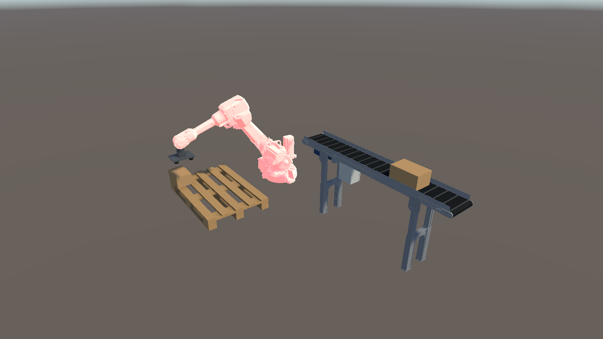

# 로봇 셀 장애 시나리오 (2단계 7일 차)

1단계 컨베이어 장애 6종([protocol.md](protocol.md) 5절)에 로봇 셀 장애 4종을 더했다. 원칙은 같다 —
**장애는 현실(더미 서버) 쪽에서 일어나고, 서버는 판단을 보내지 않으며, 트윈은 원시 신호의 조합으로 알아챈다.**

HMI에서는 알람 목록·가운데 배너·로봇 셀 카드로 보인다 (8일 차, [Twin/README.md](../Twin/README.md) HMI 절):

## 장애 버튼과 대응

| 서버 버튼 | 서버(현실)가 하는 일 | 트윈이 받는 원시 신호 | 트윈의 판단·대응 |
| --- | --- | --- | --- |
| 로봇 통신 끊김 | 로봇 컨트롤러와 트윈 사이 네트워크만 끊음 (`NetworkRelay`, 4840→4841 중계 차단). 로봇은 계속 일한다 | 세션 KeepAlive 실패 (`BadSecureChannelClosed`), 재접속 거부 | 알람 `robot_link`, 로봇을 마지막 수신 자세로 멈추고 회색조. 출구를 떠난 박스는 "통신 끊김 중 출구를 떠남"으로 처리. 재접속 후 끊긴 동안 바뀐 값(SourceTimestamp가 재접속 이전)으로 그리퍼를 맞추되, 놓인 위치·집은 박스는 **지어내지 않는다** — "끊긴 동안 적재 n개" 경고만 |
| 비상정지 | 그 자리에서 정지, 모터 전원 차단, 프로그램 정지. 해제 1초 뒤 모터 ON, 멈춘 동작을 이어 감 (컨트롤러 시계 정지). 진공은 유지 | `EmergencyStop`, `MotorsOn`, `ExecutionState` | 알람 `robot_estop` → 해제 후 1초간 `robot_motors_off`. 로봇 붉은 맥동. 컨베이어는 별개 설비라 계속 돌고 박스는 출구에 쌓여 기다린다 (잼 아님) |
| 흡착 실패 | 다음 픽에서 진공을 켜도 압력 스위치가 안 잡힘 → 1초 뒤 진공 OFF, 프로그램 정지(픽 위치 대기). 해제하면 재시도 | `DO_VacuumOn` ON인데 `DI_VacuumOk` OFF, 이어서 `ExecutionState` Stopped | **서버는 "실패"를 보내지 않는다.** 진공 출력 ON 0.5초 넘게 압력 스위치 OFF면 트윈이 `robot_vacuum`(흡착 실패)으로 판단, 다음 흡착 성공까지 유지. `robot_program_stopped`, 8초 뒤 `exit_wait`(박스가 스토퍼에 있는데 로봇이 안 집음 — MQTT와 OPC UA를 합쳐야 보이는 상태). 로봇 주황 맥동 |
| 관절 엔코더 이상 | 관절각 노드의 StatusCode를 `BadSensorFailure`로 (값은 마지막 값). 로봇은 계속 움직임 | StatusCode Bad (상태가 바뀔 때 한 번) | `RobotGate`가 버림 → 마지막 정상 자세 유지, 알람 `robot_joint_bad`, 회색조 60%. 정상 값이 다시 올 때까지 유지. 그동안 놓인 박스는 위치를 지어내지 않고 지운다 |

### 컨베이어와의 상호작용

- 로봇이 멈추면(비상정지·흡착 실패·통신 끊김 중 실제 정지) 박스가 출구 스토퍼 뒤로 쌓인다. 트윈은 출구가 막혀 있는 동안 뒤 박스의 잼 판단 거리를 멈추므로 거짓 잼이 나지 않는다 (6일 차).
- 통신 끊김은 로봇만의 문제다. MQTT 컨베이어 신호는 계속 오므로, 로봇이 박스를 집어 가는 것은 출구 해제(MQTT)로 보인다.

## 검증 (`TwinPlayCheck` + 서버 버튼 자동 조작)

트윈을 플레이 모드로 90초 돌리며, PowerShell UI Automation이 서버 창의 버튼을 시나리오대로 누른다
(로봇 접속 후 6s 비상정지 → 12s 해제 → 20s 흡착 실패 → 34s 해제 → 42s 엔코더 이상 → 47s 해제 → 52s 통신 끊김 → 62s 복구).
플레이 점검은 알람이 켜지고 꺼지는 순간을 기록한다.

| 항목 (2026-10-26) | 결과 |
| --- | --- |
| 장애별 알람 | 4종 모두 기대한 알람이 뜨고 해제 후 사라짐 (위 표) |
| 거짓 알람·잼 | 0 (시작 직후 서버 기동 중 `broker`·`robot_link`는 실제 상황) |
| 정상 구간 집기 오차 (맞추기 전) | 평균 2.8mm, 최대 9.0mm |
| 놓기 오차 | 평균 1.0mm, 최대 1.8mm |
| 통신 끊김 | 재접속 1.1초 만에 복구, "끊긴 동안 적재 3개" (서버 사이클 수와 일치) |

### 시험으로 찾아 고친 것

| 증상 | 원인 | 수정 |
| --- | --- | --- |
| 비상정지 뒤 "추적 밖 물건" 연속, 70초 무렵 거짓 잼 4건 | 출구 짝 판정이 `TravelM`(출구 대기 중 멈춤)을 써서 줄 서 있던 박스가 짝을 못 찾음 | 짝 판정을 추정 위치 `FrontM`으로 (`ItemTracker`) |
| 엔코더 이상 도중 알람이 꺼짐 | Bad는 상태가 바뀔 때 한 번만 오는데 "최근 3초 거부"로 판정 | 정상 값이 올 때까지 유지하는 상태로 |
| 정상 처리 중 "출구 대기" 경고 | 밀린 박스를 처리할 때 로봇 사이클(4.5s) 동안 기다리는 것은 정상 | 기준 3s → 8s |
| 시작 직후 "모터 OFF" 1초 | 첫 상태값을 받기 전 기본값(false)으로 판단 | 첫 `MotorsOn` 수신 전에는 상태 알람 보류 |
| 엔코더 이상 중 집은 박스가 1m 떨어져 붙음 | 트윈 자세가 멈춰 있는 동안 실제 로봇이 집음 | 압력 스위치 ON = 박스 윗면이 패드에 붙음 → TCP에 맞춰 붙임 (맞추기 전 오차는 진단값으로 기록) |
| 재접속 직후 출구의 **다음** 박스를 가져옴 | 끊긴 동안 이미 집은 박스의 흡착 신호를 지금 출구의 박스와 짝지음 | 끊긴 동안 켜진 흡착이면 벨트에서 가져오지 않고 출처 불명 박스로 |
| 비상정지 중 거짓 "흡착 실패" | 서버가 압력 형성 시간을 컨트롤러 시계(비상정지 중 정지)로 셈 | 진공(공압)은 실제 시간으로 형성·해제 (`RobotController.UpdateVacuum`) |
| 재접속 후 "끊긴 동안 적재" 경고 두 번 | 1.5초 시간 창으로 판정해 재접속 직후의 실시간 사이클이 섞임 | SourceTimestamp가 재접속 이전인 값만 "끊긴 동안 바뀐 값"으로 |
